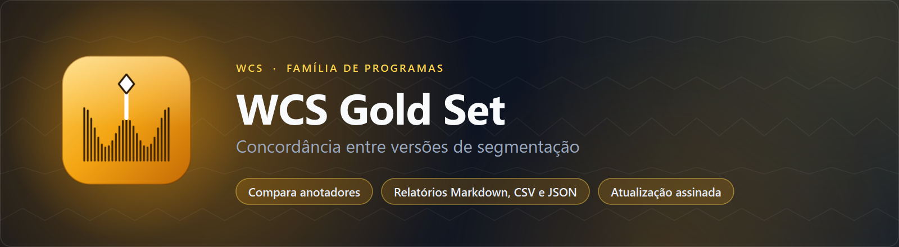

  

  
  
  
  

  <a href="https://github.com/LeoDG20/wcs-gold-set-releases/releases/latest"><b>⬇&nbsp; Baixar a versão mais recente</b></a>

Mede a **concordância entre versões de segmentação** do [Whisper Corpus Studio](https://github.com/LeoDG20/whisper-corpus-studio-releases/releases/latest): cada pessoa segmenta os mesmos áudios, manda sua versão (TextGrids do Praat) e o programa mostra, sem planilha, onde as versões concordam e onde divergem.

## Recursos

- **Versões:** importe um `.zip` exportado pelo WCS, uma pasta de TextGrids ou arquivos soltos.
- **Concordância:** nota de 0 a 100, erro médio das fronteiras (ms), acerto dentro da tolerância, viés e rótulos iguais.
- **Detalhamento:** por áudio, por fronteira e por transição de fonemas; com três ou mais versões, todas contra todas.
- **Exportação:** relatório em Markdown, CSV e JSON, e um pacote de TextGrids para importar de volta no WCS.

## Instalação

1. Em [Releases](https://github.com/LeoDG20/wcs-gold-set-releases/releases/latest), baixe **`WCS-Gold-Set-Setup-<versão>.exe`**.
2. Execute o instalador. Requer Windows 10 ou 11 (64 bits); não precisa de administrador.
3. Se aparecer *“O Windows protegeu o computador”*, clique em **Mais informações → Executar assim mesmo** (veja a pergunta abaixo).

## Atualização automática e segurança

O programa instalado verifica este repositório e se atualiza sozinho, baixando apenas o que mudou. Antes de aplicar qualquer arquivo ele confere a **assinatura Ed25519** contra a chave pública embutida nele; arquivo sem assinatura válida é recusado. A chave privada fica apenas com o autor e nunca é publicada.

## Perguntas frequentes

<b>Por que o Windows mostra um aviso ao instalar?</b>

O instalador não usa certificado comercial de editor, então o SmartScreen avisa para qualquer programa novo. A autenticidade é garantida pela assinatura Ed25519 descrita acima. Clique em **Mais informações → Executar assim mesmo**.

<b>Os parâmetros calibrados aqui chegam ao WCS?</b>

Sim: o autor os publica como pacote assinado no canal de parâmetros do WCS, que os aplica ao auto-segmentar.

<b>Como desinstalo?</b>

Em **Configurações do Windows → Aplicativos → Aplicativos instalados**.

<b>Para que servem os outros arquivos de cada release?</b>

Só o instalador (`Setup.exe`) interessa a quem instala. `manifest.json`, `package.zip`, `patch.zip` e os arquivos `.sig` são usados pela atualização automática e pela verificação de assinatura.

## Programas da família

| Programa | Função | Download |
| --- | --- | --- |
| Whisper Corpus Studio | Curadoria do corpus: segmentar, revisar e exportar o dataset. | [Baixar](https://github.com/LeoDG20/whisper-corpus-studio-releases/releases/latest) |
| WCS-Net Trainer | Treino das redes neurais a partir do dataset exportado pelo WCS. | [Baixar](https://github.com/LeoDG20/wcs-net-trainer-releases/releases/latest) |
| **WCS Gold Set** | Concordância entre versões de segmentação (você, orientador, colegas). | [Baixar](https://github.com/LeoDG20/wcs-gold-set-releases/releases/latest) |

---

Repositório de distribuição: o código-fonte é privado. Dúvidas ou problemas: abra uma <a href="https://github.com/LeoDG20/wcs-gold-set-releases/issues">issue</a>. 
© 2026 Leo Gobbi · uso acadêmico (TCC/IC).
